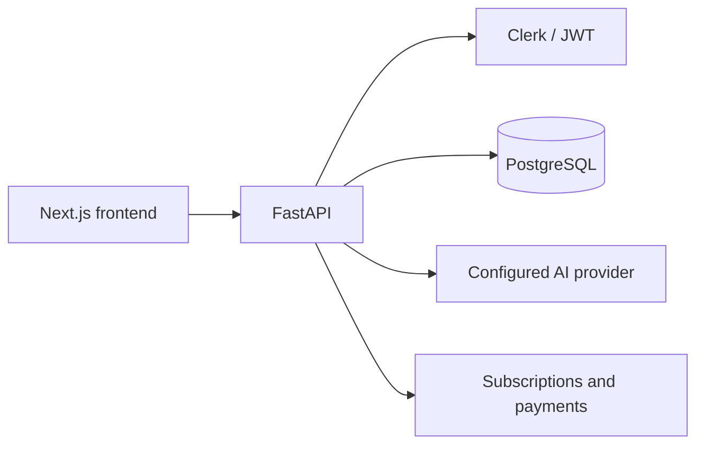

# AI Image Generator — Backend

FastAPI backend for the image-generation application, paired with [fe-image-generator](https://github.com/axay7021/fe-image-generator).

## What is implemented

- Image processing and generation routes.
- Clerk and JWT authentication integrations.
- PostgreSQL models and Alembic migrations.
- Subscription plans, usage quotas, payment integrations and administrative APIs.



## Run locally

Use Python 3.10+ and PostgreSQL. Copy `.env.example` to `.env`, configure the database, authentication and model credentials, and replace example secrets.

```sh
uv sync
uv run alembic upgrade head
uv run uvicorn app.main:app --reload --port 8000
```

API documentation: `http://localhost:8000/docs`. Consult `app/core/settings.py` for configuration options. Payment providers are needed only for the billing flows you use.

## Portfolio presentation

This backend and its frontend are **one portfolio project**, not two projects. The companion frontend includes a credential-free visual walkthrough: run `node scripts/serve-portfolio.mjs` there. It uses labelled illustrative assets rather than calling paid services.

Source deployment workflows require manual execution and retain the original runner configuration for reference; configure your own infrastructure before using them.
